<p align="center">
  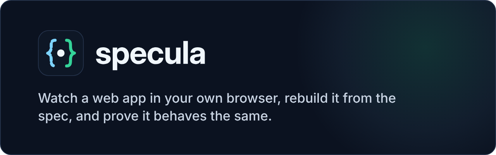
</p>

<p align="center">
  <a href="https://github.com/synthentica/specula/actions/workflows/ci.yml"></a>
  
  
  <a href="LICENSE"></a>
</p>

Understand how a web feature works by watching it in your own browser, write
down what you learned as a spec, build your own version from that spec, and
**prove** it behaves the same by replaying what the browser recorded.

<p align="center">
  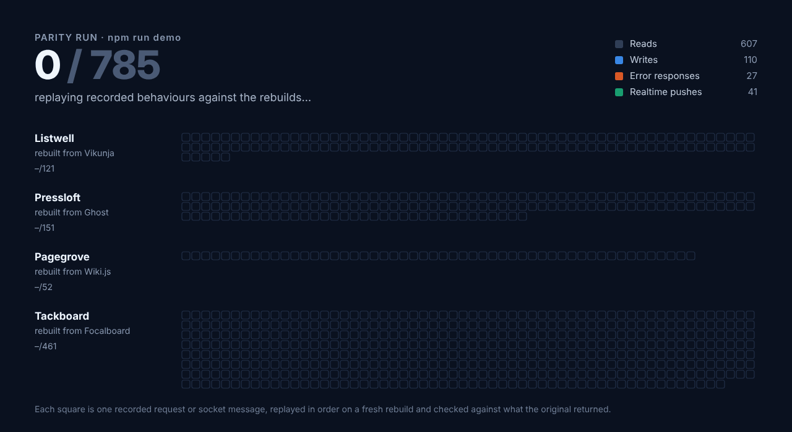
</p>

> Four real apps, four independent rebuilds written from the spec alone:
> **785/785 recorded behaviours reproduced** (Vikunja 121/121, Ghost 151/151,
> Wiki.js 52/52, Focalboard 461/461), across REST, GraphQL and live WebSocket
> pushes, including error responses, token refresh after expiry and kanban
> moves.
>
> The look is captured too, as layout and design tokens without any text,
> logo or image, and scored separately: the four rebuilds went from **32–54 to
> 91–98 out of 100** on the visual check with every behaviour still passing.

specula is a Claude Code skill plus small Node 22 helpers on top of
[chrome-devtools-mcp](https://github.com/ChromeDevTools/chrome-devtools-mcp).
The point is learning and building your own, not copying a product: rebuilds
take behaviour, layout and style, never names, logos, images or text. The
name is Latin for a watchtower, the place you observe from, and it starts with
*spec*, the thing you write down.

## Try it in one command

```bash
npm install
npm run demo
```

No Docker, Chrome or network needed. The demo starts each rebuild on a fresh
in-memory instance, replays every recorded flow against it and checks the
answers, including the messages it pushes over WebSockets. It takes under a
minute (one flow waits out a 15-second token lifetime, as recorded) and writes
no files:

```text
| Target | Parity | Checked |
|---|---|---|
| focalboard | 461/461 | 46179 keys, 2045 list sizes, 483 values, 1653 flags |
| ghost | 151/151 | 9032 keys, 223 list sizes, 323 values, 1052 flags |
| vikunja | 121/121 | 3858 keys, 71 list sizes, 225 values, 240 flags |
| wikijs | 52/52 | 3565 keys, 80 list sizes, 97 values, 58 flags |

Every recorded behaviour reproduced by the rebuild.
```

`npm run demo -- ghost` runs one target. To click around a rebuild yourself:
`PORT=4457 node targets/ghost/rebuild/server.ts`, then open
<http://localhost:4457/>.

## What the rebuilds look like

Each rebuild was written by an agent that saw only the spec, so the screens are
its own: own name, wording, icons and seed content. Since the
[UI spec](#the-look-ui-spec-and-visual-check) joined the pipeline, the layout,
views and style follow the original's. These are the four running on fresh
instances, filled in by replaying the recorded flows.

<table>
<tr>
<td width="50%">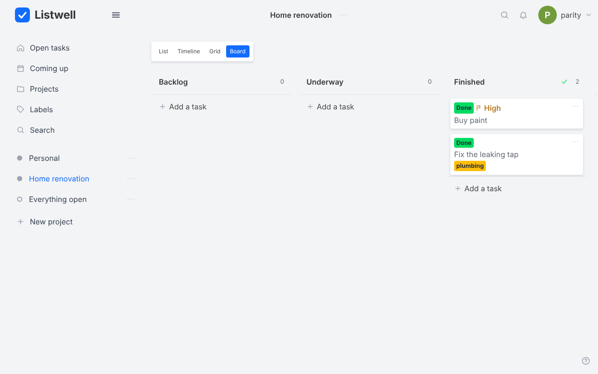<br><b>Listwell</b> (from Vikunja): projects, lists, a kanban board, labels, due dates</td>
<td width="50%">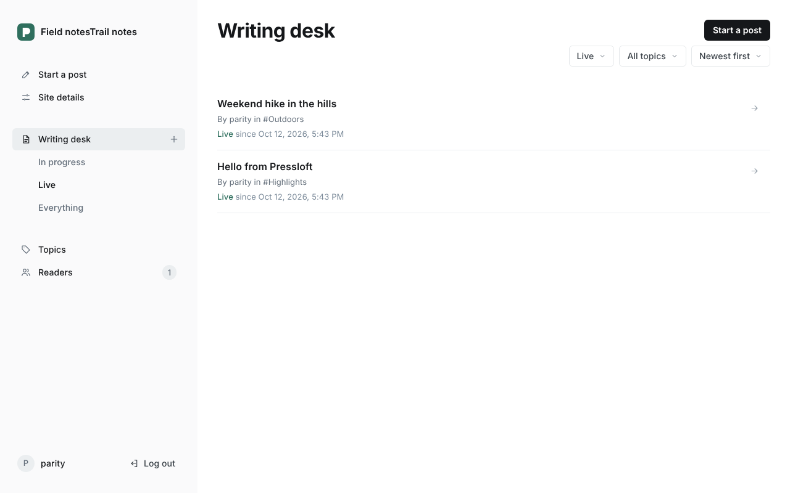<br><b>Pressloft</b> (from Ghost): drafts, publishing, topics, readers, site settings</td>
</tr>
<tr>
<td width="50%">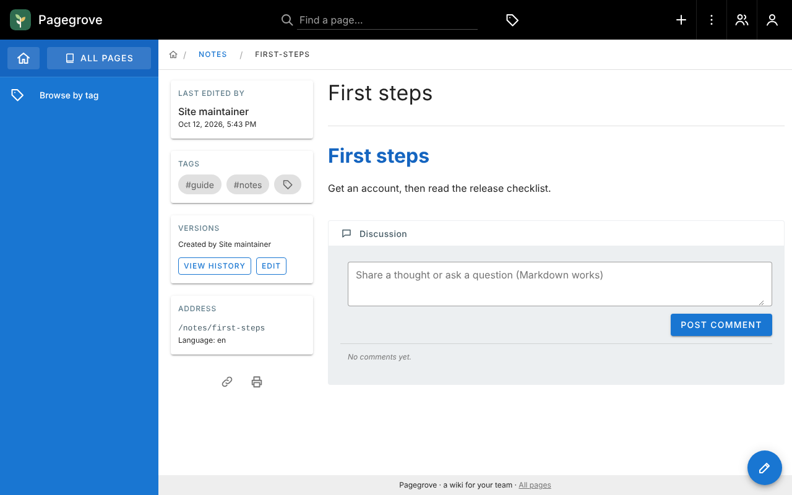<br><b>Pagegrove</b> (from Wiki.js): Markdown pages, history, tags, comments, people</td>
<td width="50%">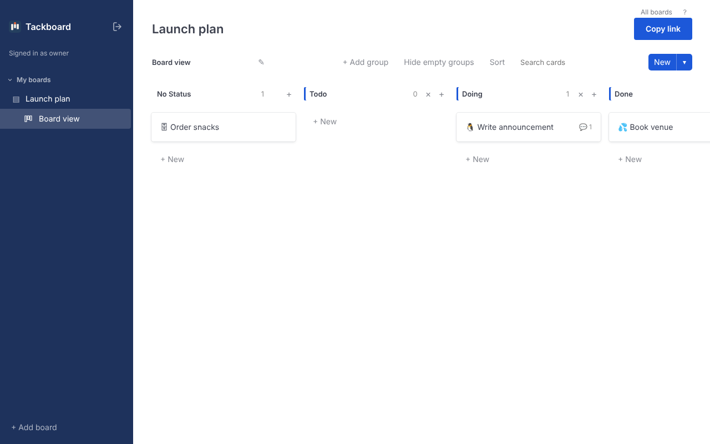<br><b>Tackboard</b> (from Focalboard): boards, status groups, cards that update live in every open window</td>
</tr>
</table>

## How it works

<p align="center">
  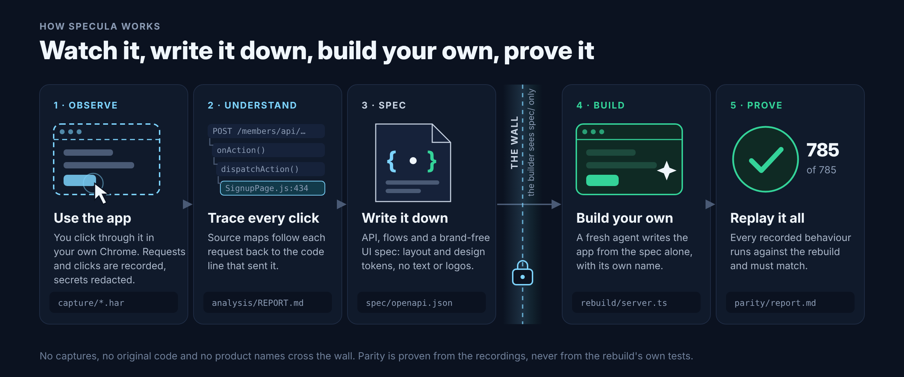
</p>

<details>
<summary>The same pipeline as a diagram, with every helper script</summary>

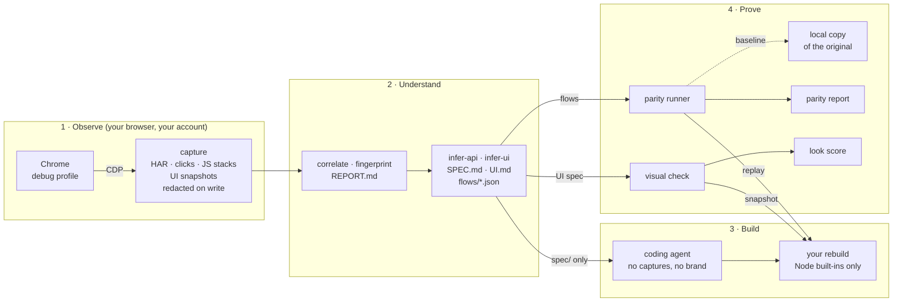

</details>

| Stage | What happens | Output |
|---|---|---|
| Capture | You use the app normally in a dedicated Chrome profile. A CDP helper next to chrome-devtools-mcp records every request, the DOM action that caused it and the JavaScript stack that sent it. Cookies, tokens and personal data are redacted before anything touches disk. | `targets/<t>/capture/` |
| Analyze | Each click is linked to its requests and, through source maps when they exist, to the code that sent them. Framework, auth model, realtime channels and feature switches are identified with evidence. | `targets/<t>/analysis/REPORT.md` |
| Spec | Requests become operations and schemas; ids are typed by entity so later steps can refer back to earlier responses; product names are neutralized. UI snapshots become a brand-free UI spec: views, regions, components and design tokens. | `targets/<t>/spec/` |
| Build | A separate agent that can read only `spec/` builds the app with its own name, wording and icons, laid out and styled after the UI spec. | `targets/<t>/rebuild/` |
| Parity | The recorded flows are replayed in order against a fresh rebuild, and the original itself as a baseline. | `targets/<t>/parity/` |
| Visual | Each view of the seeded rebuild is opened in headless Chrome and scored against the UI spec, separately from behaviour. | `targets/<t>/parity/visual.md` |

The skill in [.claude/skills/specula/SKILL.md](.claude/skills/specula/SKILL.md)
drives these stages from Claude Code; each stage is also a plain script
(`npm run capture`, `correlate`, `fingerprint`, `infer-api`, `infer-ui`,
`parity`, `visual`).

## Why parity tests

"An AI rebuilt this app" is easy to claim and hard to check. specula makes the
claim testable: the browser's own recordings become the test suite, so nobody
writes the tests to fit the rebuild.

**What one step checks.** Each recorded request is replayed with ids and
tokens bound from earlier responses of the same run. It passes when the status
code and content type match, every recorded response key exists with the same
JSON type, lists of records have the recorded size, every value the user typed
comes back unchanged, every true/false flag matches (`done`, `published`,
feature switches) and error codes match. Ids, timestamps and other server-made
values are not compared.

**Realtime counts too.** WebSocket messages are part of the flows: what the
client sent is replayed on a socket of the run's own, and every message the
server pushed after a step (a card created, a column renamed, a task deleted)
is one more behaviour. It passes when a message of the same kind arrives and
compares like a response body, so a rebuild that saves correctly but forgets
to tell the other open tabs fails.

**Not just the happy path.** The suites include recorded failures and
time-dependent behaviour:

- Errors: a deleted task or post (404), a malformed filter (400), a wrong
  password (403 / 422), a taken username or member email (400 / 422). Captures
  keep a wrong password distinct from the real one, so the replay sends a wrong
  password exactly where the user typed one.
- GraphQL errors, which arrive with status 200: a wrong password, a page path
  that is taken and a duplicate user are reported inside the result
  (`succeeded: false` with an error code), a missing page as a GraphQL `errors`
  entry with its code and the line and column of the failing field. Their codes
  are compared like HTTP error codes.
- Token refresh: the local original runs with 15-second access tokens and the
  recording stays idle past expiry. Replay skips idle time except where it was
  at least one token lifetime long, so the rebuild has to renew an expired
  token with its refresh cookie, as the original did.
- Kanban: creating a column, moving a card between columns, and the rule that
  moving a card into the done column marks the task done.
- An ended session (the publishing admin has no token refresh): the server
  answers 403, the user signs in (once with a wrong password) and the client
  returns to the page that was opened.

**Why the tests can be trusted.** Before a rebuild is scored, the same suite
runs against a fresh local copy of the original. It passes 121/121, 151/151,
52/52 and 461/461, so a failure against the rebuild means the rebuild differs, not that the test
is broken.

**Why the rebuild cannot cheat.** The rebuild agent sees `spec/` only: no
captures, no analysis, no product name. The checker reads no rebuild code. When
the checker had to change, the change was made generic and re-verified on every
target (for example: strings the server showed before the client sent them
back count as server data, not user input). The first two rebuilds were then extended
by the same kind of agent when the specs gained the new flows. The third and
fourth rebuilds were each written by a fresh agent from their spec in one
pass.

**What passing does not prove.** Only recorded behaviour is covered.
Features nobody clicked are not built, and errors that were never observed are
not checked. Recording is passive and uses one account, so access to another
user's data and the server's answer to an expired token (the client always
refreshes first) are not tested. More flows make a stronger claim, and every
report says exactly what it checked.

## The look: UI spec and visual check

The first rebuilds behaved like the originals but looked like plain prototypes.
The pipeline now records how each screen is put together and holds the rebuild
to it, without letting any of the original's content through.

**What is captured.** While you record flows, capture runs a read-only probe in
the page about 1.5 seconds after each navigation or click and writes
`<flow>.ui.json`: the regions of the screen (top bar, sidebar, main area,
footer, dialog), the components by kind (filled, outline and text buttons,
inputs, cards, columns, tabs, tables, badges, avatars and so on) with their
boxes and computed styles, and usage histograms of colours, fonts, sizes,
radii, shadows and spacing. It reads no text, attribute values, class names or
image sources, so nothing the original wrote or drew is stored.

**What the rebuild agent sees.** `npm run infer-ui` turns the snapshots into
`spec/ui/tokens.json` (page, surface, text, accent and border colours, font
stack and sizes, radius and shadow scales), `spec/ui/views.json` (each view's
regions and component groups) and a readable `spec/UI.md`. The agent still
reads `spec/` only and picks its own name, wording and icons; logos, images
and the original's text never reach it.

**How it is scored.** `npm run visual` replays the flows on a fresh instance
so it holds the same records, signs in through the app's own form, opens each
view at 1280×800 and compares a new snapshot with the UI spec: layout 40 %
(where regions and components sit on the first screen), components 30 %
(count, size and style per kind) and style 30 % (page colours, accent, font,
base size, radius). The score is reported next to parity, never mixed into it,
with the largest differences listed in words (`parity/visual.md`).

<p align="center">
  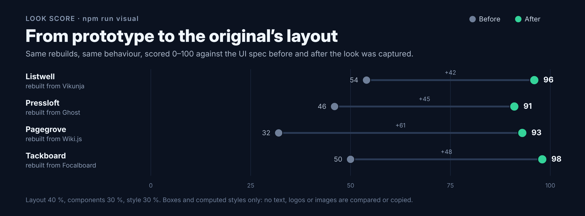
</p>

| Rebuild | Look before | Look after | Behaviour after |
|---|---|---|---|
| Listwell (Vikunja) | 54 | **96** | 121/121 |
| Pressloft (Ghost) | 46 | **91** | 151/151 |
| Pagegrove (Wiki.js) | 32 | **93** | 52/52 |
| Tackboard (Focalboard) | 50 | **98** | 461/461 |

Each rebuild was restyled by a spec-only agent that changed the UI files and
left the server alone; the full parity suite was rerun afterwards and still
passes 785/785.

What a high score does not mean: it compares boxes and computed styles, not
pixels, and only on the first screen of the views in the UI spec. Text, icons
and images are deliberately not compared. The four targets here were recorded
before the probe existed, so their reference snapshots were taken with
`npm run visual -- --original` on a seeded local copy (views listed under
`ui` in `target.json`). The visual check, like the parity baseline, only runs
against instances you start yourself.

## From a click to the original source line

Every recorded request carries the JavaScript stack that sent it, including
the async steps in between. When the browser receives a public source map, the
analysis follows that stack back to the original files. Ghost's member sign-up
widget (loaded from a CDN together with its source map) shows the whole path
of one click on its public site:

```text
click "Sign up"  →  POST /members/api/send-magic-link/  201, 27 ms later

src/components/pages/SignupPage.js:434   onAction('signup', {name, email, phonenumber, plan, token});
src/App.js:981                           onAction: (_action, data) => this.dispatchAction(_action, data)
src/App.js:688                           const updatedState = await ActionHandler({action, data, state: this.state, api: this.GhostApi});
src/actions.js:587                       return await handler({data, state, api}) || {};
src/actions.js:108                       await api.member.sendMagicLink({emailType: 'signup', integrityToken, ...data});
src/utils/api.js:290                     const res = await makeRequest({
src/utils/api.js:31                      return fetch(url, options);
```

The file names and line numbers come from the analysis
([REPORT.md](targets/ghost/analysis/REPORT.md#member-signup)); the code is
quoted from the source map's embedded sources. The same click also fetched
an integrity token first (`src/actions.js:107`), which the trace shows as a
separate request with the same origin.

Capture keeps every script from the app's own origin plus any CDN script that
sent a request to the app, and loads a script's map from that script's own
origin, the way DevTools does. Without a map the trace still points at the
exact line and function in the minified bundle. That is the case for Vikunja
and for Ghost's admin, whose bundles name source maps that the server answers
with 404.

## Results at a glance

| | Vikunja | Ghost | Wiki.js | Focalboard |
|---|---|---|---|---|
| App | task manager, Vue, JWT + WebSocket | publishing admin, Ember + React, session cookie | team wiki, Vue, GraphQL + JWT | kanban boards, React, opaque token + WebSocket pushes |
| Recorded flows / API exchanges | 12 / 109 + 24 socket messages | 11 / 151, plus 1 public-site flow | 13 / 52 (batched GraphQL) | 9 / 432 + 53 socket messages |
| Public source maps | none | sign-up widget only; admin maps answer 404 | none | none |
| Inferred operations | 27 | 46 | 21 GraphQL + 1 REST | 24 + 8 message kinds |
| Baseline (original vs. its own recordings) | 121/121 | 151/151 | 52/52 | 461/461 |
| Rebuild from `spec/` only | Listwell | Pressloft | Pagegrove | Tackboard |
| **Parity** | **121/121** | **151/151** | **52/52** | **461/461** |
| Response keys / list sizes / values / flags checked | 3858 / 71 / 225 / 240 | 9032 / 223 / 323 / 1052 | 3565 / 80 / 97 / 58 | 46179 / 2045 / 483 / 1653 |
| Look vs. UI spec (views) | 96/100 (5) | 91/100 (4) | 93/100 (4) | 98/100 (1) |

All four originals run locally from Docker
(`targets/<name>/docker-compose.yml`). Each rebuild uses Node built-ins only (`node:http`, `node:sqlite`) and a
framework-free TypeScript UI.

## Results: Vikunja

Twelve flows recorded in a local Vikunja v2.7.0 (register, create project, add
tasks, edit task, labels, search, delete task, upcoming overview, log out and in,
errors, kanban, token refresh): 109 API exchanges plus 24 WebSocket messages
(the client signing in on its socket and the server confirming it).

| Stage | Result | File |
|---|---|---|
| Analyze | every recorded action linked to its requests and the minified code that sent them; stack, auth model, realtime and feature switches identified with evidence | `targets/vikunja/analysis/REPORT.md` |
| Spec | 27 operations, 9 schemas, 12 replayable flows | `targets/vikunja/spec/` |
| Spec vs. real API | 27/27 inferred operations exist in the real OpenAPI; response field recall 90%, precision 97%, type agreement 100%; the flows exercised 13% of the 202 real operations | `targets/vikunja/analysis/spec-vs-source.md` |
| Baseline | the original (run with 15-second access tokens) passes its own recorded suite 121/121, so the tests are valid | `targets/vikunja/parity/baseline.md` |
| Rebuild | a separate agent built a task manager from `spec/` alone: Node built-ins only (`node:http`, `node:sqlite`), framework-free TypeScript UI, own name and wording | `targets/vikunja/rebuild/` |
| Parity | **passes 121/121 recorded behaviours** (3858 response keys, 71 list sizes, 225 values, 240 flags checked) | `targets/vikunja/parity/report.md` |

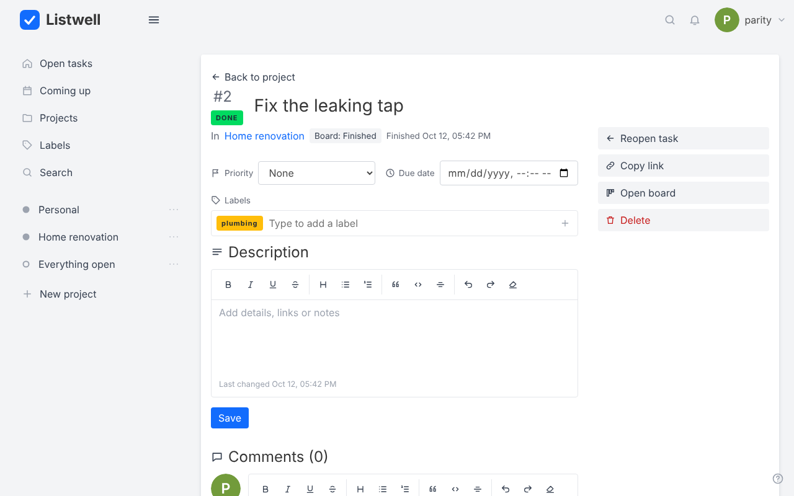

The first version passed 57/57 on the nine happy-path flows. With the three new
flows and the stricter checker it scored 91/110 until a spec-only agent added
the kanban board (also in the UI, with drag and drop), problem+json errors with
the recorded codes, and a configurable token lifetime. When socket messages
joined the flows (see Focalboard below), the 12 recorded socket sign-in
confirmations became behaviours of their own: 121, all passing without a
change to the rebuild.

What this does and does not show: the rebuild reproduces every recorded
request/response behaviour, including four error cases, renewal of an expired
token and the done-column rule. It does not prove equivalence beyond the
recordings: sharing, teams, attachments, bucket limits and reordering inside a
column were never recorded and are not built.

## Results: Ghost

Eleven flows recorded in a local Ghost 5.130 admin (owner setup, write a post,
publish, tag it, add a member, change site settings, browse posts by status,
delete a draft, log out and in, errors, an ended session): 151 API exchanges.
A twelfth flow, a reader signing up on the public site, is recorded for the
source-map trace above; it uses the members API, which is outside the admin
spec and not part of the parity suite.

| Stage | Result | File |
|---|---|---|
| Analyze | 59 actions linked to 99 requests; Ember app with React islands, session-cookie auth; the sign-up click traced to original source lines | `targets/ghost/analysis/REPORT.md` |
| Spec | 46 operations, 11 replayable flows, SPEC.md without the product's name (`/ghost/` became `/app/`) | `targets/ghost/spec/` |
| Baseline | the original passes its own recorded suite 151/151 | `targets/ghost/parity/baseline.md` |
| Rebuild | Pressloft: a publishing admin built from `spec/` alone, own name, wording and seed content | `targets/ghost/rebuild/` |
| Parity | **passes 151/151 recorded behaviours** (9032 response keys, 223 list sizes, 323 values, 1052 flags checked) | `targets/ghost/parity/report.md` |

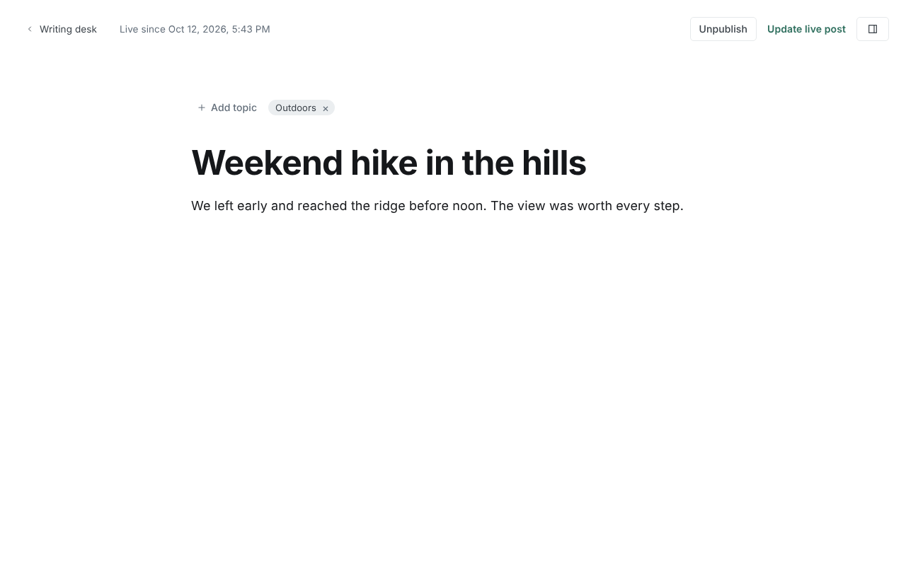

A second, quite different app is what made the pipeline general. Ghost needed:
24-hex ids bound by entity (also bare `id`s inside `{ "posts": [ ... ] }`
bodies), the `updated_at` a client echoes for optimistic locking, ids and
"now"-relative times inside filter strings (replayed as templates), objects
keyed by record ids, and a baseline mode that maps the neutralized API prefix
back to the original. The rebuild agent's first score was 104/126: every
failure was one seed string (a role description) that the client sends back
unchanged. The checker now treats strings the server showed before the client
sent them as server data, not user input; Vikunja kept 57/57 with the same 123
value checks.

The new flows scored 145/151 on the first version: three feature switches in
the server config had the wrong value and two errors lacked the recorded
`property` and `code`. After the spec-only extension Pressloft passes 151/151,
shows its own error messages, and returns a signed-out visitor to the page
they opened.

Caveats: one baseline step (a member activity query with a one-second time
window) differed on the original itself in 2 of 9 runs, and again in 1 of 5
runs after the new flows were added.
Ghost publishes no machine-readable API description, so there is no
spec-vs-source comparison like Vikunja's. The sign-up widget was recorded in
a sandbox that cannot reach the CDN, so the identical npm package was served
locally ([targets/ghost/cdn-mirror.sh](targets/ghost/cdn-mirror.sh)); on a
normal machine Ghost loads it from jsDelivr. Unrecorded features (scheduling,
email sending, paid members, comments) are not built.

## Results: Wiki.js (GraphQL)

Thirteen flows recorded in a local Wiki.js 2.5 (setup, sign in with a wrong and
a right password, create pages with tags, edit, comment, browse by tags,
search, page history, add a user twice, delete a page, errors, sign out and in):
52 requests to two endpoints. Almost everything is `POST /graphql`, and the
client batches: one request can carry five operations.

| Stage | Result | File |
|---|---|---|
| Analyze | every action linked to its GraphQL operations by name (`POST /graphql (mutation pages.create)`), plus a table of the 21 operations with the failures each one returned | `targets/wikijs/analysis/REPORT.md` |
| Spec | `graphql.json` with the exact documents, variable and result shapes; 13 replayable flows; SPEC.md without the product's name | `targets/wikijs/spec/` |
| Baseline | the original passes its own recorded suite 52/52 | `targets/wikijs/parity/baseline.md` |
| Rebuild | Pagegrove: a wiki built from `spec/` alone, with a hand-written GraphQL engine (no dependencies), its own wording for all 937 UI strings and its own seed names | `targets/wikijs/rebuild/` |
| Parity | **passes 52/52 recorded behaviours** (3565 response keys, 80 list sizes, 97 values, 58 flags checked) | `targets/wikijs/parity/report.md` |

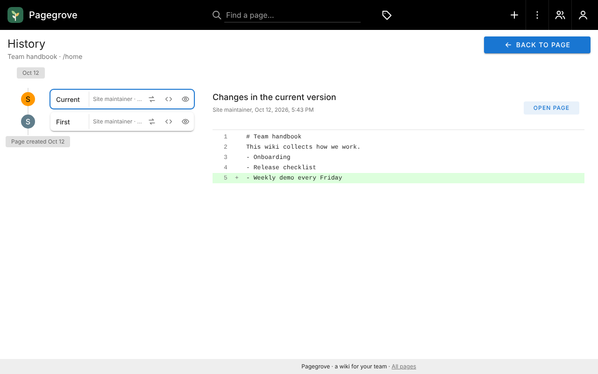

GraphQL hides everything REST spreads over URLs, so the pipeline learned to
read the request bodies: a small GraphQL reader (no dependency) names each
anonymous operation by its fields, binds a variable by the field that takes it
(`pages { single(id: $id) }` → a page id), and compares failures reported
inside a 200 response. The recording also exposed three capture gaps, all
fixed generically: camelCase password fields (`adminPassword`) were not
redacted, so the leak scan now also checks the known test password; every
email became the same placeholder, so a second user's address is now numbered;
and a response body could be lost when the page navigated right after a save,
so capture now holds each XHR response until it has been read. The original
restarts itself after setup, which the flow records as an app wait.

Caveats: no source maps are served, so code locations point into minified
bundles. Search only ever returned no hits in the recordings, the token's
30-minute renewal was never reached, and permissions for non-admin users were
not observed; the rebuild's choices for those are listed in its README.

## Results: Focalboard (realtime)

Nine flows recorded in a local Focalboard 7.8.9 (sign up, create and name a
board, add three status columns, add three cards, set a card's status and
write a description and a comment, drag a card to another column, delete a
card, errors, sign out and in): 432 API exchanges and 53 WebSocket messages.
Every change the user makes comes back over the socket as a push, to every
open tab including the one that made it.

| Stage | Result | File |
|---|---|---|
| Analyze | every action linked to its requests; React app, opaque session token, a CSRF header on every call, one socket with eight message kinds | `targets/focalboard/analysis/REPORT.md` |
| Spec | 24 operations, 8 message kinds, 9 replayable flows with the socket messages in place, SPEC.md without the product's name | `targets/focalboard/spec/` |
| Baseline | the original passes its own recorded suite 461/461: 432 requests and 29 pushed messages | `targets/focalboard/parity/baseline.md` |
| Rebuild | Tackboard: a kanban app built from `spec/` alone, with a hand-written WebSocket server (no dependencies), 13 board templates of the recorded shape in its own words, and live updates in the UI | `targets/focalboard/rebuild/` |
| Parity | **passes 461/461 recorded behaviours** (46179 response keys, 2045 list sizes, 483 values, 1653 flags checked) | `targets/focalboard/parity/report.md` |

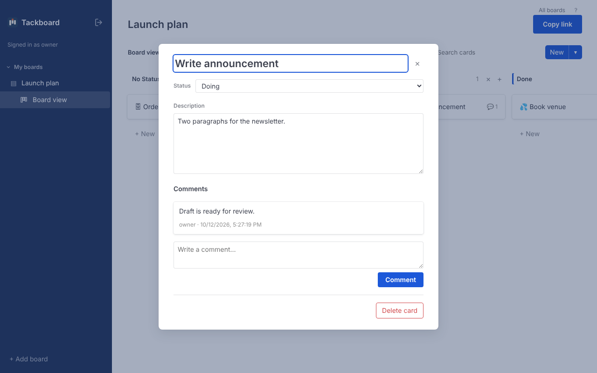

Realtime made the pipeline treat socket messages as part of a flow instead of
a separate handshake check: a message the client sent is a step, a push is
expected after the step that caused it, and pushes are matched by kind and
content in any order within the flow. Focalboard also needed four generic
fixes, each re-verified on the other three targets: random 27-character ids
are recognised as ids; an id taken from a list binds by a field the user typed
(`$[?title="Write announcement"].id`) instead of its position, since the
original returns blocks in storage order; such unordered lists compare as
sets; and constant client headers (`X-Requested-With`) are replayed.

Caveats: no source maps are served. Only one user ever touched a board, so
pushes to other users' sockets, permissions and sharing were not observed;
the rebuild's choices for those are listed in its README. The Planka app was
the first choice for this target, but its container image could not be
downloaded in the sandbox used here.

## A hosted service

The pipeline was also run in its intended setting: Claude Code on a Mac
driving the author's own Chrome through chrome-devtools-mcp, against a live
hosted web analytics service and a real account rather than a local container.
Fourteen flows (sign in, add a website, browse its statistics, rename it, share
links, short links, tracking pixels, a custom board, account settings, and
deleting each of them) gave 130 API exchanges across two hosts, the app's own
and a regional API gateway. A rebuild written from the spec alone passed
130/130, and its look scored 97/100.

That run's recordings, spec and rebuild are kept private: the service's terms
restrict republishing its content. What this repository does carry are the
generic fixes the real service forced, each re-verified on the four targets
above (their specs regenerate identically and their rebuilds still pass in
full):

- `target.json` `apiOrigins`: the API lives on another host than the UI.
- `target.json` `flowOrder`: the session existed before the first capture,
  so sign-in was recorded last but has to replay first.
- A share link's token arrives in a response and goes back in a header of its
  own; flows now carry it as `tokenHeaders`, and the replay no longer mistakes
  it for the login token.
- Random base62 slugs (`/share/<16 random characters>`) are path parameters
  and bind to the response that created them.
- Turbopack is told apart from Vite.
- The redactor learns the account's own identifiers without being told: the
  name next to the account's email, a linked sign-in provider's user id, the
  client IP address a session records, and the browser id an ad tag copies
  from its cookie into its own URLs.
- A list recorded empty must come back empty when records appear in it.

## Run it on your own target

1. Start the app you want to understand somewhere you are allowed to observe it,
   ideally a local copy (or a hosted service with your own account, where its
   terms allow it), and open it in a dedicated Chrome debug profile
   ([reference/capture.md](.claude/skills/specula/reference/capture.md)).
2. In Claude Code, ask the `specula` skill to capture a few flows, then
   analyze, spec, rebuild and parity-test them. Add `targets/<name>/target.json`
   with the brand words to neutralize. Set `SPECULA_CAPTURE_PASSWORD` (and
   `SPECULA_CAPTURE_EMAIL` when a flow creates other users) while recording.
   Capture records the UI snapshots on the way, and the skill runs
   `infer-ui` next to `infer-api`, so the rebuild gets the layout and style
   without extra steps.
3. Score the look with `npm run visual -- --target <name> --base-url <url>`
   once the rebuild has a `rebuild/views.json` mapping each view to its route
   ([reference/parity.md](.claude/skills/specula/reference/parity.md#visual-check-how-the-views-look)).
4. Run `npm test` for the helpers' own tests (32).

Rules the pipeline keeps: only apps you may observe (your own instance, or
a hosted service whose terms allow it), passive observation only (what the browser already
receives with your own account; no probing, fuzzing or auth bypass), secrets and
personal data redacted before writing, and no brand names, logos, images or
original text in rebuilds; the look is carried over as layout and design
tokens only.

## Repository layout

| Path | What it holds |
|---|---|
| `.claude/skills/specula/` | The skill and one reference page per stage |
| `src/` | Stage scripts (`capture`, `correlate`, `fingerprint`, `report`, `infer-api`, `infer-ui`, `parity`, `visual`, `demo`) |
| `src/lib/` | CDP client, HAR writer, redactor, schema inference, GraphQL reader, brand neutralizer, UI probe, UI spec and scoring, headless Chrome tab |
| `targets/<name>/` | Per target: Docker setup, captures, analysis, spec, rebuild, parity reports. The scripts and source maps a capture fetched (`capture/sources/`) are the observed apps' own code and stay on the machine that recorded them, so links into them from `REPORT.md` resolve only there |
| `docs/` | Screenshots, README graphics and the logo |
| `test/` | Node test runner suites, including an end-to-end capture against a local fixture app |

## Credits

Inspired by [morluto/rea](https://github.com/morluto/rea) (MIT), which covers
reverse engineering of local software; specula applies the idea to web apps
and adds parity tests. Targets: [Vikunja](https://vikunja.io),
[Ghost](https://ghost.org), [Wiki.js](https://js.wiki) and
[Focalboard](https://www.focalboard.com), all open source and run locally.
Their names belong to their owners; the rebuilds use none of them.

## License

[MIT](LICENSE) for specula's own code, skill and rebuilds. The recordings and
specs under `targets/` describe how the open-source apps above behaved on a
local instance with test data, and are published for study.
